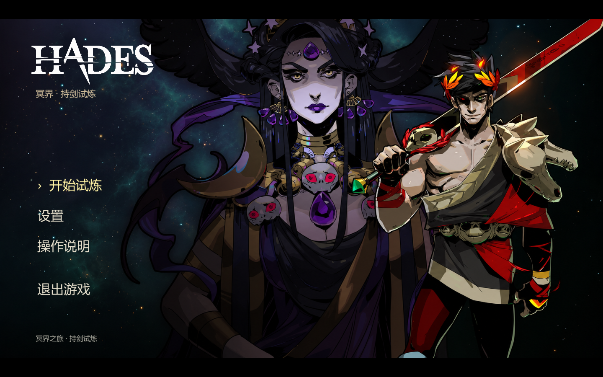
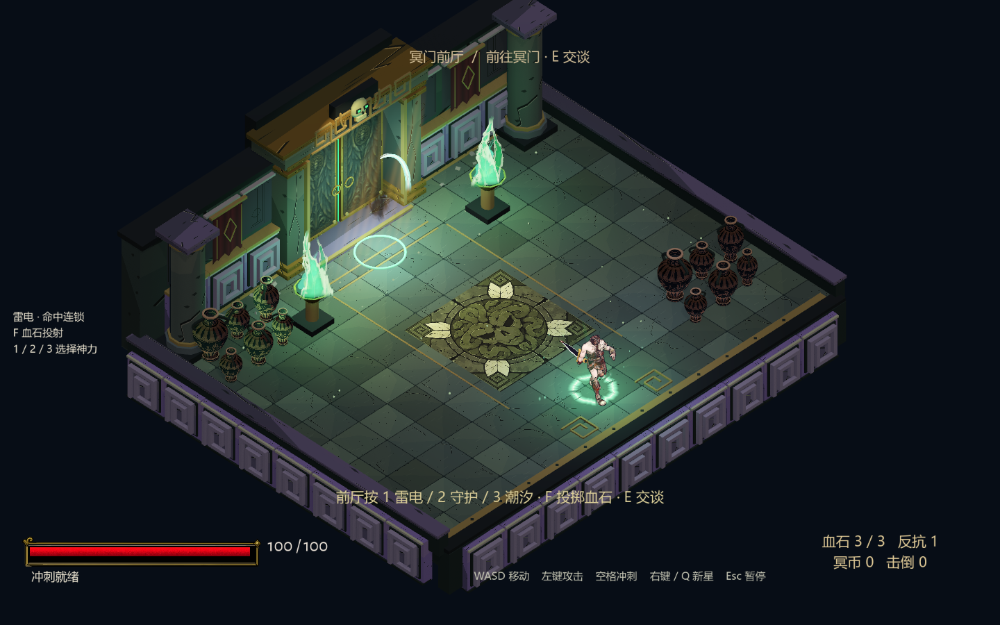
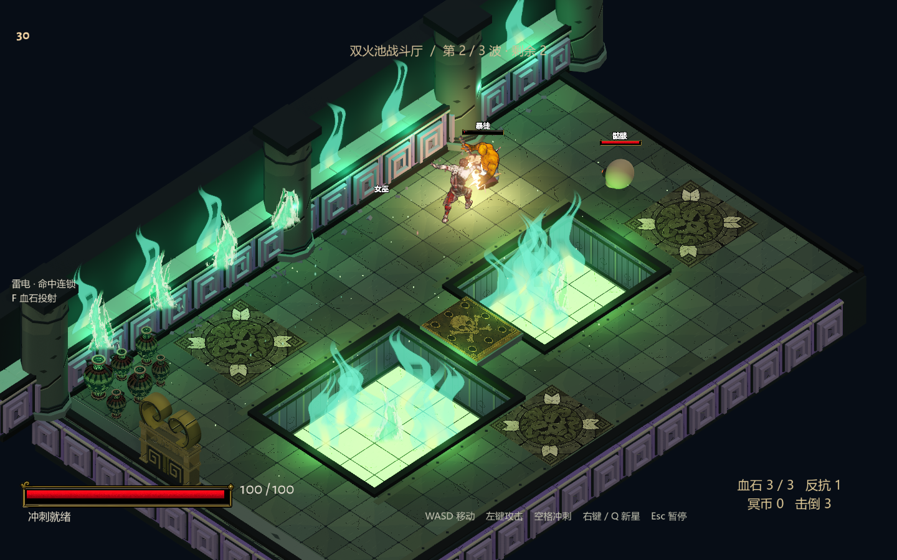
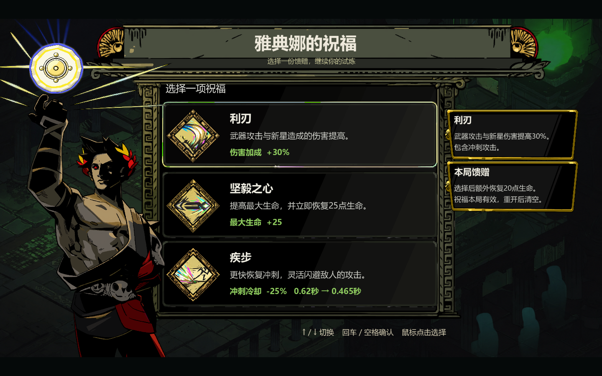
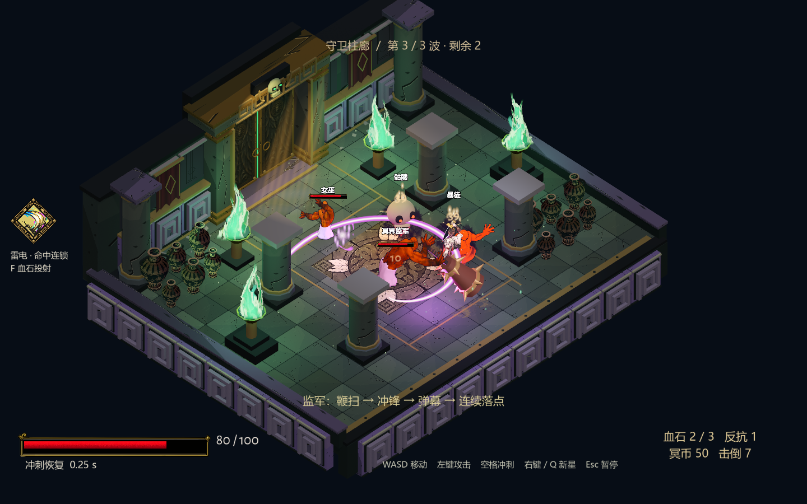

# hades-learning-demo

A playable, three-room Godot demo studying the visual language and combat presentation of *Hades*. This project combines the environment, character animation, combat effects, lighting, UI, and audio work into one menu-to-results flow.

**Non-commercial educational use only.** This is a source-available recreation study under [LICENSE](LICENSE), with separate third-party terms in [NOTICE](NOTICE.md). It is unofficial and is not affiliated with or endorsed by Supergiant Games. Hades, its characters, and associated trademarks belong to Supergiant Games and their respective rights holders.

The recorded visual-production workflow uses public online videos and screenshots as references, AI-assisted generation, and manual/procedural work. It does not involve cracking, bypassing DRM, or extracting assets from original game packages. Audio and fonts have separate CC0/OFL origins; they are not all AI-generated.

**The game interface is Chinese. These documents are English; there is no in-game English language switch.**

[中文说明](README.zh-CN.md) · [Playing](docs/english/PLAYING.md) · [Building](docs/english/BUILDING.md) · [Architecture](docs/english/ARCHITECTURE.md) · [Asset provenance](docs/english/ASSET_PROVENANCE.md)

*Actual native screenshot from this demo's packaged build. This is not an original Hades screenshot.*

## Play

Windows builds are distributed through [Releases](https://github.com/Be1Human/hades-learning-demo/releases). Extract the archive and double-click `HadesDemo.exe`; keep `HadesDemo.pck` beside it.

Builds and the Godot toolchain are local outputs, not guaranteed contents of a source clone. The public build script exports to `build/HadesDemo.exe` and `build/HadesDemo.pck`. Open the executable from Windows File Explorer; a browser may display or download a local file instead of executing it.

The target is **Windows x64, Godot 4.7.2, Forward+ / Vulkan**. Chinese text needs an installed **Microsoft YaHei** or **Noto Sans CJK SC** system font; a CJK font is not embedded. See [Building](docs/english/BUILDING.md) for setup and reproducible validation commands.

## What is playable

Start at the main menu, enter the entrance hall, talk at the gate, clear two waves in the twin-pit room, claim a reward and one of three upgrades, then face the boss wave in the colonnade. Victory and defeat both lead to retry or return-to-menu choices.

The demo includes sword combos, dash attacks, a nova attack, recoverable bloodstone casts, lightning/deflect/tide effect families, mixed enemy types, and one death-defiance revival per run. Settings include saved volume, mute, and fullscreen state. There is no shop, persistent run save, permanent progression, or full original-game story.

**Quick controls:** WASD to move, mouse to aim, left-click to attack, Space to dash, right-click or Q for nova, F to cast, E to interact, and Esc to pause. Choose an effect family with 1/2/3 in the entrance or a cleared room. The three family choices are separate from the three numerical reward upgrades. See [Playing](docs/english/PLAYING.md) for the exact flow and effects.

## Inside the demo

*Entrance hall — the beginning of a playable three-room run.*

*Twin-pit combat — actual sword contact and game-driven effects.*

*Boon selection — Chinese labels and three upgrades with real gameplay effects.*

*Final-room boss encounter — a rig variant with a telegraphed whip attack. All screenshots in this section show this demo, not the original game.*

## Evidence and scope

The public source snapshot contains the runtime implementation, necessary resources, bilingual documentation, and selected demo media. Internal development histories, reference captures, private review records, caches, and raw capture frames are excluded.

For **v0.1.0**, the public snapshot completed a clean import and Windows export with Godot 4.7.2 on the current Windows host. `public_smoke.gd` passed **13/13** checks and `combat_smoke.gd` passed **11/11**, both at fixed 60 fps. This verifies a clean source build on the same host; a separate new-machine build has not been verified. See [Building](docs/english/BUILDING.md) to repeat the checks.

Controlled tests and natural input replays remain separate: package recordings load the final PCK with the matching engine, while release-EXE startup is checked independently.

Original-game visual fidelity remains unaccepted. In particular, some textures and architectural details differ; the witch and boss reuse the available rig as variants; held-club/hem intersections and some foot drift remain. Victory can freeze an enemy's fall during the transition to results. The AE work verifies a conversion/playback research pipeline, not a supplied production AE library.

## Source layout

- `project.godot` — project configuration; main scene is `scenes/frontend/main.tscn`.
- `scripts/frontend/` and `scripts/ui_systems/` — menus, settings, dialogue, rewards, and results.
- `scripts/gameplay/`, `scripts/integration/`, and `scripts/demo01/` — current gameplay layers and retained combat foundations.
- `assets/` and `shaders/` — runtime resources and rendering.
- `tests/` and `tools/` — public smoke validation and export helpers.
- `docs/english/` and `docs/public-demo/` — documentation and selected actual-demo media.

See [Architecture](docs/english/ARCHITECTURE.md) before changing the layered campaign implementation.

## Attribution and asset boundaries

The project license does not replace third-party terms or grant rights over Hades intellectual property. See [Asset provenance](docs/english/ASSET_PROVENANCE.md) and [NOTICE](NOTICE.md) for the distinctions between authored, AI-assisted, reference-derived, and third-party resources.
