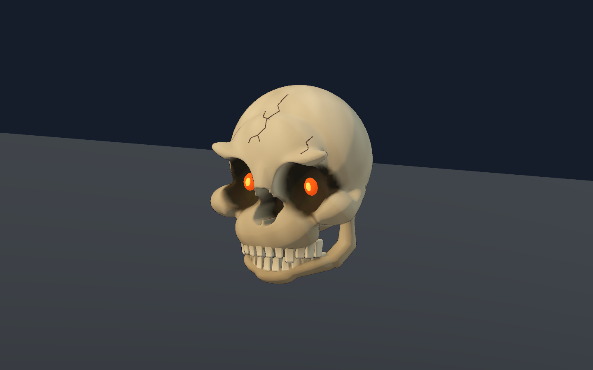

# hades-learning-demo · 冥界试炼

这是一个使用 Godot 搭建的三房间可玩 Demo，集中整合场景、角色动作、战斗特效、照明、UI 和音效。**仅限非商业学习用途**，按 [LICENSE](LICENSE) 提供可查看源码，第三方条款见 [NOTICE](NOTICE.md)。项目非官方，与 Supergiant Games 无关联，也未获其背书；Hades 及相关角色、商标归 Supergiant Games 与相应权利人所有。

已记录的视觉制作流程以公开网络视频、截图为参考，通过 AI 辅助生成、手工及程序化制作完成；不涉及破解、绕过 DRM 或从原游戏包提取资产。音频使用 CC0 素材层叠，字体保留 OFL 条款，不将它们统称为 AI 生成素材。

[English](README.md) · [英文玩法说明](docs/english/PLAYING.md) · [英文构建说明](docs/english/BUILDING.md) · [架构](docs/english/ARCHITECTURE.md) · [素材来源](docs/english/ASSET_PROVENANCE.md)

*最终游戏包的原生实机截图，不是《哈迪斯》原作截图。*

## 启动

Windows 包通过本仓库 [Releases](https://github.com/Be1Human/hades-learning-demo/releases) 发布。解压后在资源管理器中双击 `HadesDemo.exe`，保留同目录的 `HadesDemo.pck`。公开构建脚本输出到 `build/HadesDemo.exe` 与 `build/HadesDemo.pck`。

浏览器打开脚本不一定会运行游戏。构建输出和 Godot 工具链不随源码克隆自动提供；请自行安装匹配版本并按构建文档配置 `GODOT_BIN` 与可选的 `GODOT_TEMPLATES`。

目标环境为 Windows 64 位、Godot 4.7.2、Forward+ / Vulkan。中文界面使用系统字体 Microsoft YaHei 或 Noto Sans CJK SC，包内未内嵌 CJK 字体，运行设备需具备其中一种。游戏目前是中文界面；英文文档不代表已有英文游戏切换。

## 一局流程

主菜单「开始试炼」→ 冥门前厅选属性、靠近门按 E 交谈 → 双火池厅两波战斗 → 光门领取奖励与三选一祝福 → 守卫柱廊 Boss 波次 → 胜利或死亡 → 重试或返回主菜单。

- WASD 移动，鼠标瞄准，左键三连击。
- 空格冲刺，冲刺中攻击可接冲刺攻击。
- 右键 / Q 新星，F 投掷血石；掉落后靠近回收。
- 前厅或清场时按 1 / 2 / 3 选雷电、守护、潮汐。
- E 交互，Esc 暂停；暂停菜单可重开、设置或返回主菜单。
- 菜单支持鼠标、方向键、Tab 和 Enter。

属性体系与房间奖励独立：属性改变攻击特效和实际战斗行为；清场奖励三选一为伤害 +30%、生命上限 +25，或冲刺冷却 -25%，选择另恢复最多 20 生命。每局有一次死亡反抗，恢复一半最大生命。当前没有商店、局内存档或跨局成长。

## 游戏内容

*从前厅开始，交谈后进入战斗房间。*

*真实战斗中的突刺命中与事件驱动特效。*

*中文祝福界面，三项奖励分别改变真实数值。*

*使用现有骨架变体的 Boss 战。本节图片均为本 Demo 实机画面，不是原作截图。*

## 记录与差距

### v0.1.1：冲撞骷髅重做

新版具有挖入颅骨的眼窝和鼻腔、颧弓、24 颗塑形牙齿、可动下颌、骨色与眼火；漂浮、蓄势、受击和翻落随现有战斗状态变化，保留原有伤害和碰撞规则。这张图使用固定检查灯光，不是实际游戏镜头，也不代表已达到原作级还原。

[双语前后对比页](docs/characters/skull-r01/index.html)提供四组同镜头截图、叠图滑杆和受控冲撞短片。下载页面及同目录媒体后可使用交互控件。上方旧游戏截图继续作为 v0.1.0 历史证据保留。

v0.1.1 的源码与导出 PCK 分别通过骷髅专项 55 项、前端 13 项、战斗 11 项检查，合计 **158 项通过、0 失败**。原生短片另行确认碰撞造成 12 点伤害，发行 EXE 通过限时原生启动检查；这些验证不冒充新版完整通关录像。

公开快照包含运行源码、必要素材、双语说明及精选实机媒体，排除内部历史、原作对照素材、私密记录、缓存与原始采集帧。

**v0.1.0** 的公开副本已在当前 Windows 主机使用 Godot 4.7.2 完成干净导入与 Windows 导出；固定 60 fps 运行的 `public_smoke.gd` 为 **13 项通过、0 失败**，`combat_smoke.gd` 为 **11 项通过、0 失败**。这验证了同一主机上的干净源码构建，尚不代表另一台全新机器已经通过验证。复核命令见[构建说明](docs/english/BUILDING.md)。自然输入回放、受控分支测试和独立 EXE 启动分别记录。

原作级视觉还原度仍未验收。墙面、门体、陶罐笔触与角色动作仍有差距；女巫和 Boss 使用现有骨架变体；持棒穿摆、少量滑步以及胜利结算时倒地动作冻结仍有记录。AE 原始库尚未验证，自制诊断图没有作为正式战斗素材接入。

项目许可不覆盖第三方既有条款，也不授予 Hades 知识产权权利。工程内制作、AI 辅助、参考派生与第三方素材的区别见[素材来源说明](docs/english/ASSET_PROVENANCE.md)和 [NOTICE](NOTICE.md)。
